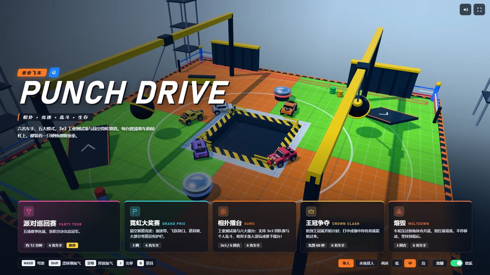
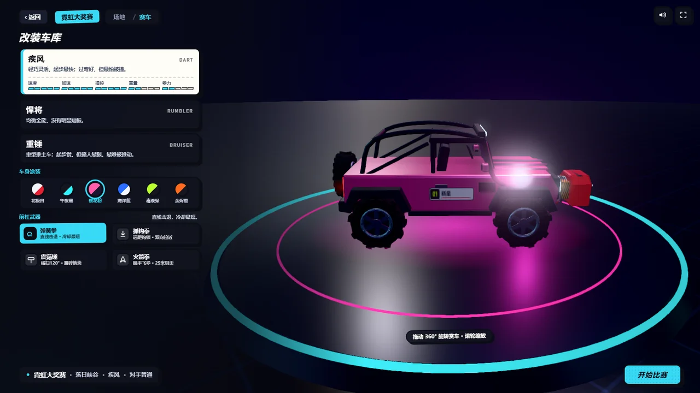
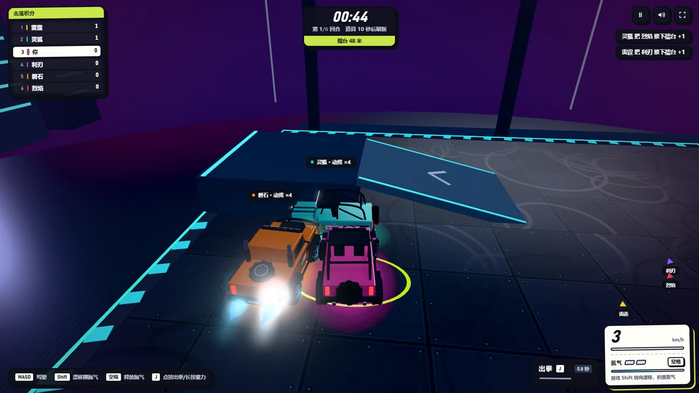
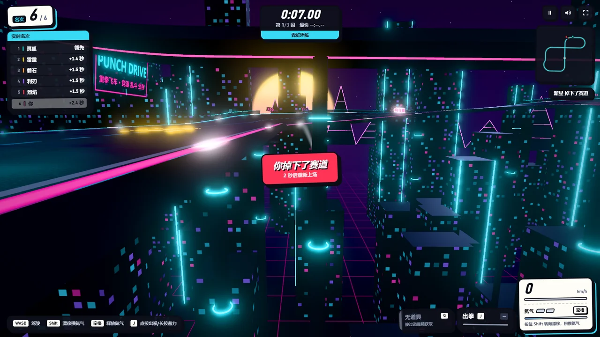

# PUNCH DRIVE · 重拳飞车

> 撞色工业测试场 3v3 相扑乱斗 × 极简斜切现代电竞 HUD × 汽车级高光烤漆小车！  
> 基于 **Three.js + cannon-es** 打造的纯前端 3D 派对竞速与物理乱斗游戏，支持离线单文件运行、键鼠 / 本地双人分屏 / 手柄 / 触屏操作。

- **在线试玩**：[https://works.sugarv.mom/sumo-cars/](https://works.sugarv.mom/sumo-cars/)
- **作品集收录**：[Sugar 创意仓库 · Idea Vault](https://works.sugarv.mom/)



## 亮点特性

- **极简斜切现代电竞 UI（全 5 模式统一）**：轻透深色毛玻璃 + 锐利斜切几何 + 90%+ 赛场留白；3v3 团队赛配备顶部蓝红三联比分牌与左右双翼战绩条，全模式标配 **3D 碰撞冲击力大字飘字**（如 `556 重拳` / `620 摆锤重击`）与紧凑斜格氮气速度仪。
- **全新旗舰场地「工业测试场」与物理机关**：亮橙 + 荧光草绿防滑网格地坪、炭灰工业高墙、红白蓝摔角弹性边绳、真实可掉落的下沉方形深坑、2 组高空物理摆锤铁球、2 个银色弹珠台反弹鼓包与可撞飞彩色油漆桶。
- **汽车级高光烤漆 3D 车模与硬核物理反馈**：
  - **疾风 `DART`**：复古圆润两厢拉力小钢炮（双赛车拉花、大掀背斜后窗、8 辐白色拉力轮毂、分色尾灯与欧式明黄尾牌）。
  - **悍将 `RUMBLER`**：曲面烤漆巴哈沙漠运动皮卡（开放后斗防滚架与双斜卧备胎、外露氮气副筒避震）。
  - **重锤 `BRUISER`**：饱满圆角宽体装甲重型越野（机械增压进气罩、推土牛栏、高位双镀铬烟囱）。
  - 全模式同步升级：高压金属火花束、22 秒持久黑色漂移胎痕、清爽蓝白双条纹速度拖尾、击飞翻滚物理与浑厚饱和器马达引擎声浪。
- **四款可换装 3D 前杠机械武器**：弹簧拳（蓝/红阵营缓冲拳垫）、抓钩拳、震荡锤、火箭拳，均支持点按快出与长按蓄力重拳。
- **五大派对玩法模式**：
  1. **派对巡回赛**（5 场连战积分争冠）
  2. **霓虹大奖赛**（霓虹环线 / 落日峡谷 2 条高架赛道 + 道具箱 + 本机幽灵车）
  3. **相扑擂台**（支持 **3v3 团队赛** 与 经典/快速 个人赛，含工业测试场等 7 张主题擂台）
  4. **王冠争夺**（抢夺并守住王冠累积 60 秒）
  5. **熔毁**（169 块六边形熔岩/赛博地块，踩过即升温塌落，支持氮气小跳）
- **零外部依赖离线单文件**：通过 `esbuild` 打包成单个离线 `Sumo Cars.html`，断网双击即可游玩。

## 实机画面

| 改装车库（复古拉力小钢炮 360° 展台） | 3v3 工业测试场（摆锤 · 深坑 · 冲击飘字） |
| :---: | :---: |
|  |  |

| 霓虹大奖赛（蓝白速度拖尾 + 斜切 HUD） | 3D 领奖台结算 |
| :---: | :---: |
|  |  |

## 操作说明

- **单人键鼠**：`WASD` 或方向键驾驶，`Shift` / `Z` 漂移积攒氮气，`空格` 释放氮气，`J` / `X` 点按出拳（按住蓄力重拳），`Q` / `K` / `C` 道具或小跳，`R` 复位，`Esc` 暂停，`F` 全屏。
- **本地双人**：1P 使用 `WASD` + 左 `Shift` + `J` / `Q` / `空格`；2P 使用方向键 + 右 `Shift` + `回车` / `/` / `.`。
- **手柄 / 触屏**：支持主流浏览器 Gamepad API 与移动端虚拟摇杆。

## 本地开发与构建

```bash
npm install
npm run build   # 构建离线单文件 Sumo Cars.html
npm run dev     # 启动本地预览 http://127.0.0.1:4179
npm test        # 运行 Playwright 全流程自动化回归验收（38 项检查）
```

## 目录结构

```text
src/
├── main.js           # 主循环、镜头、输入与比赛生命周期
├── cars.js           # 物理车辆、漂移氮气与 4 种拳套判定
├── car-visual.js     # 三款美式越野 3D 车模与 4 款机械武器程序化建模
├── maps.js           # 五大主题浮空擂台（1024px PBR 材质）
├── tracks.js         # 霓虹环线 & 落日峡谷三维高架赛道
├── hexarena.js       # 熔毁模式 169 块动态塌落六边形擂台
├── studio.js         # 360° 改装车库展台与 3D 领奖台
├── ui.js / style.css # 潮酷派对涂鸦风全套 6 大 UI 界面与 HUD
└── modes/            # 各模式规则与 AI 调度
```
