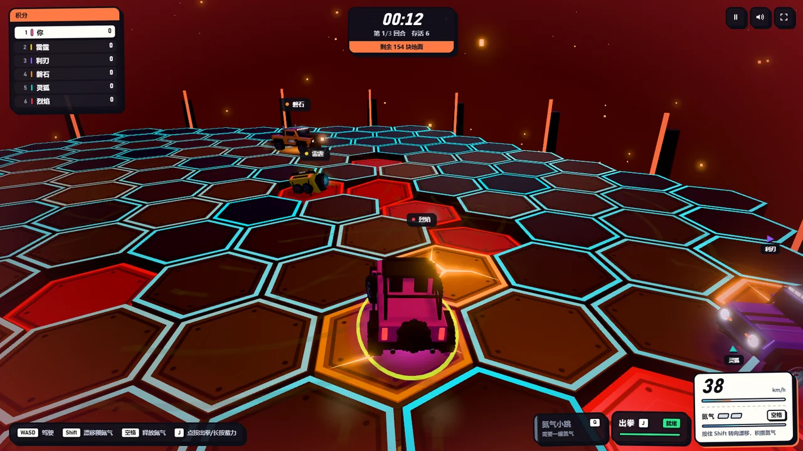
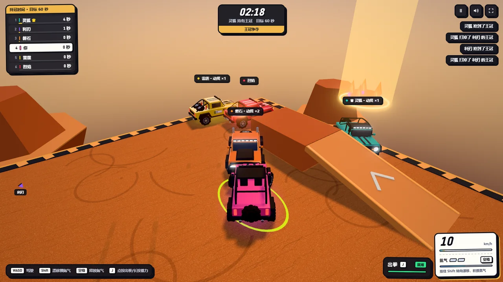
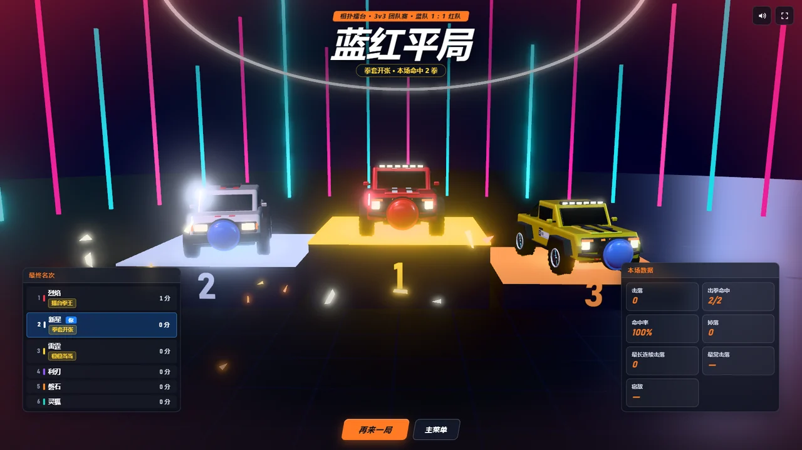

# PUNCH DRIVE · 重拳飞车

> 漂移攒氮气，用美式硬派越野车前杠重拳把对手撞出擂台！  
> 基于 **Three.js + cannon-es** 打造的纯前端 3D 派对竞速与物理乱斗游戏，支持离线单文件运行、键鼠 / 本地双人分屏 / 手柄 / 触屏操作。

- **在线试玩**：[https://works.sugarv.mom/sumo-cars/](https://works.sugarv.mom/sumo-cars/)
- **作品集收录**：[Sugar 创意仓库 · Idea Vault](https://works.sugarv.mom/)


## 亮点特性

- **潮酷派对涂鸦风 UI**：粗墨黑描边、硬切偏移投影、5 大模式动态撞色与实体按压交互；全套 6 大界面（大厅、选场地、改装车库、局内 HUD、暂停、3D 领奖台）零滚动条锁屏适配。
- **三款美式硬派越野 3D 车模**：
  - **疾风 `DART`**：短轴宽体硬派越野（圆形 LED 光环大灯、半敞篷全景钢管防滚架、涉水喉、尾门外挂泥地大备胎）。
  - **悍将 `RUMBLER`**：巴哈沙漠越野皮卡（倒 C 日行灯、中网三点琥珀灯、开放后斗防滚架与斜卧双备胎、外露氮气副筒避震）。
  - **重锤 `BRUISER`**：重装装甲越野猛兽（机械增压进气罩、推土装甲牛栏前杠、高位双镀铬烟囱排气管）。
- **四款可换装 3D 前杠机械武器**：弹簧拳、抓钩拳、震荡锤、火箭拳，均支持点按快出与长按蓄力重拳。
- **五大派对玩法模式**：
  1. **派对巡回赛**（5 场连战积分争冠）
  2. **霓虹大奖赛**（霓虹环线 / 落日峡谷 2 条高架赛道 + 道具箱 + 本机幽灵车）
  3. **相扑擂台**（6 张主题浮空擂台 + 随回合缩圈推人）
  4. **王冠争夺**（抢夺并守住王冠累积 60 秒）
  5. **熔毁**（169 块六边形熔岩/赛博地块，踩过即升温塌落，支持氮气小跳）
- **零外部依赖离线单文件**：通过 `esbuild` 打包成单个离线 `Sumo Cars.html`，断网双击即可游玩。

## 实机画面

| 改装车库（360° 3D 展台） | 霓虹大奖赛 |
| :---: | :---: |
|  |  |

| 相扑擂台（霓虹港湾） | 熔毁（熔岩核心） |
| :---: | :---: |
|  |  |

| 王冠争夺（赤岩峡谷） | 3D 领奖台结算 |
| :---: | :---: |
|  |  |

## 操作说明

- **单人键鼠**：`WASD` 或方向键驾驶，`Shift` / `Z` 漂移积攒氮气，`空格` 释放氮气，`J` / `X` 点按出拳（按住蓄力重拳），`Q` / `K` / `C` 道具或小跳，`R` 复位，`Esc` 暂停，`F` 全屏。
- **本地双人**：1P 使用 `WASD` + 左 `Shift` + `J` / `Q` / `空格`；2P 使用方向键 + 右 `Shift` + `回车` / `/` / `.`。
- **手柄 / 触屏**：支持主流浏览器 Gamepad API 与移动端虚拟摇杆。

## 本地开发与构建

```bash
npm install
npm run build   # 构建离线单文件 Sumo Cars.html
npm run dev     # 启动本地预览 http://127.0.0.1:4179
npm test        # 运行 Playwright 全流程自动化回归验收（38 项检查）
```

## 目录结构

```text
src/
├── main.js           # 主循环、镜头、输入与比赛生命周期
├── cars.js           # 物理车辆、漂移氮气与 4 种拳套判定
├── car-visual.js     # 三款美式越野 3D 车模与 4 款机械武器程序化建模
├── maps.js           # 五大主题浮空擂台（1024px PBR 材质）
├── tracks.js         # 霓虹环线 & 落日峡谷三维高架赛道
├── hexarena.js       # 熔毁模式 169 块动态塌落六边形擂台
├── studio.js         # 360° 改装车库展台与 3D 领奖台
├── ui.js / style.css # 潮酷派对涂鸦风全套 6 大 UI 界面与 HUD
└── modes/            # 各模式规则与 AI 调度
```
